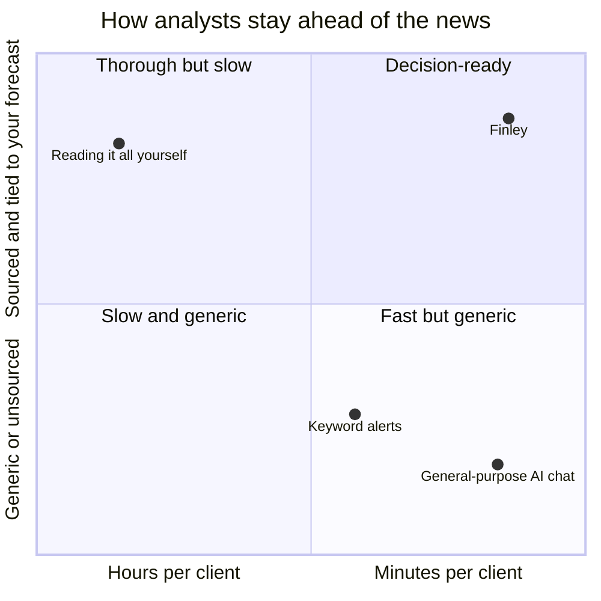
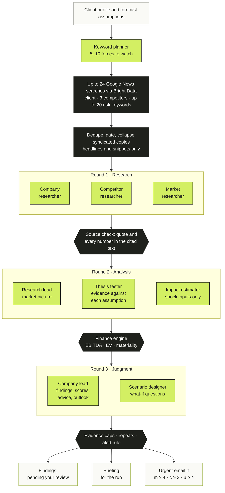
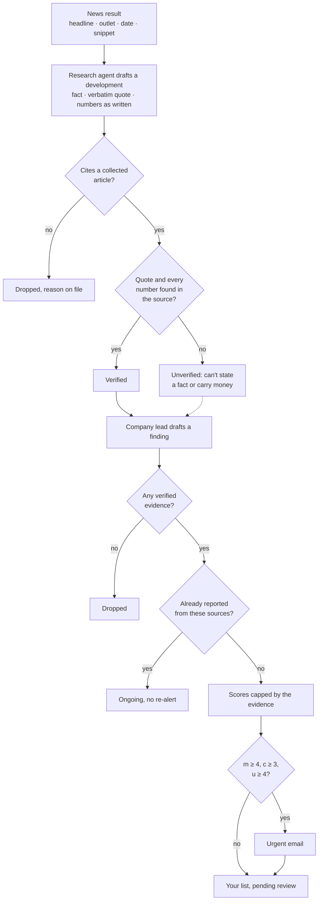
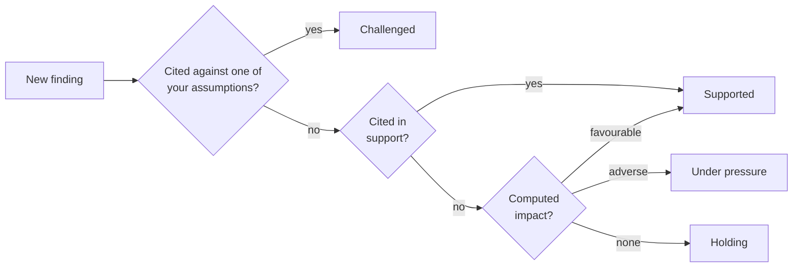
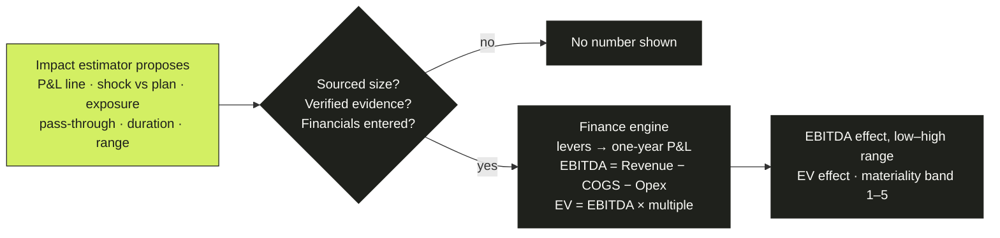
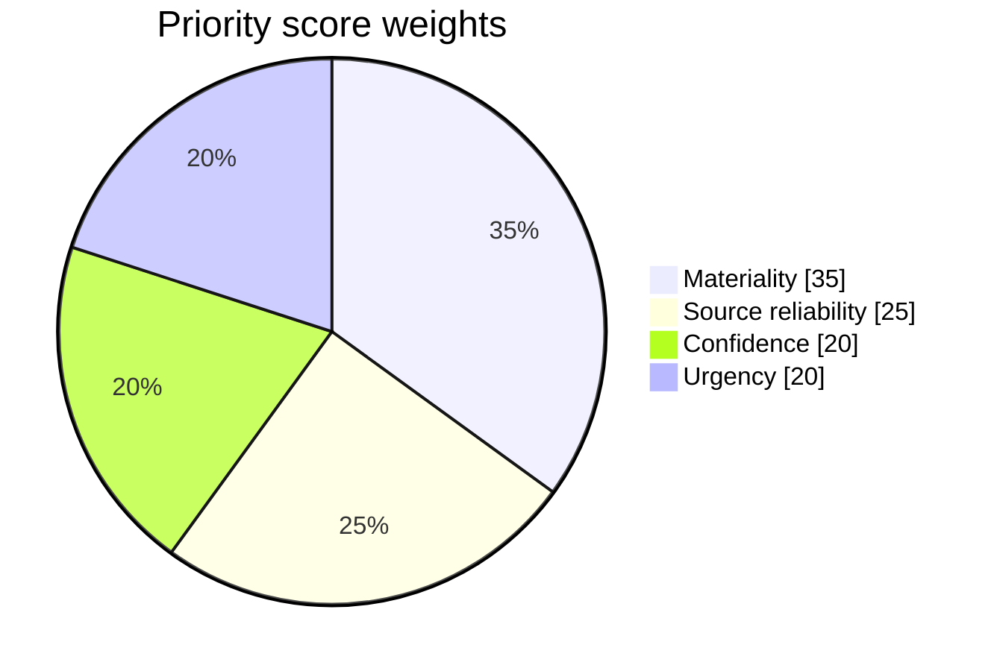
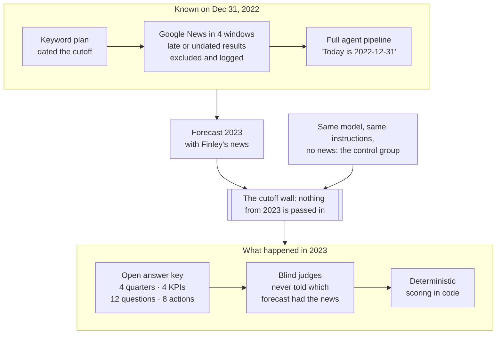
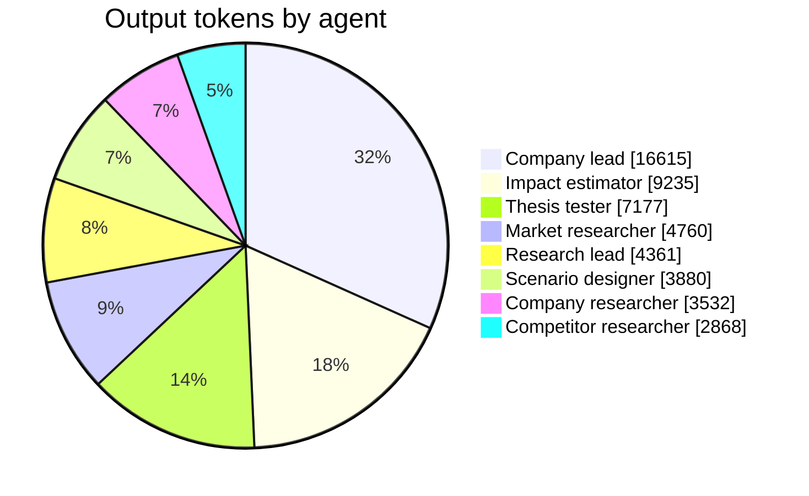
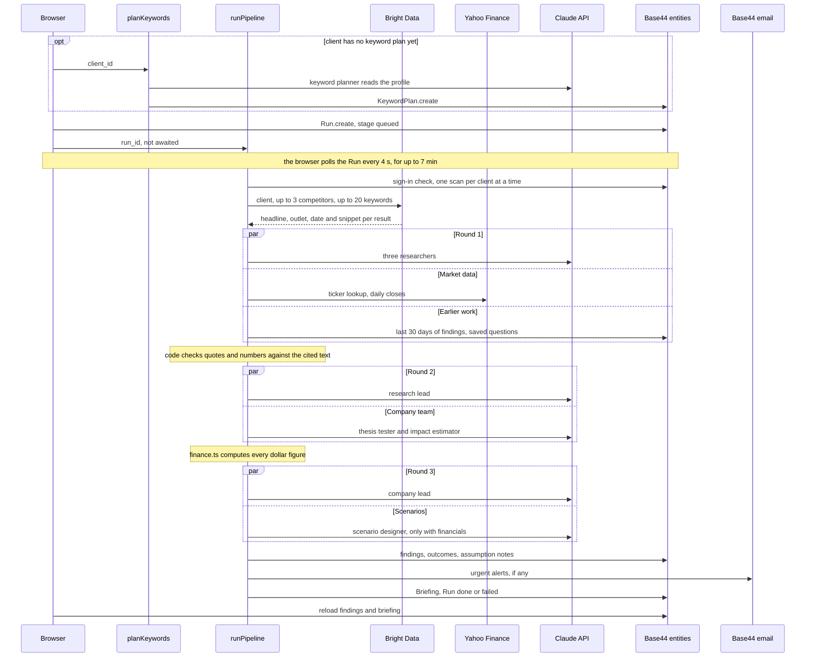

<div align="center">

# Finley

### Know which forecast assumptions just broke.

Finley reads the news that matters to each of your clients, tests it against the assumptions behind their forecast,<br/>and shows you the math before you change a number.

[](#how-it-works)
[](#how-it-works)
[](#under-the-hood)
[](#under-the-hood)
[](#checks)

**[Why Finley](#why-finley)** · **[How it works](#how-it-works)** · **[Why you can trust it](#why-you-can-trust-it)** · **[The backtest](#one-more-thing)** · **[Tour](#a-tour-of-the-workspace)** · **[Your data](#your-data)** · **[Run it](#run-it-yourself)**

</div>

---

> Every forecast is a stack of bets.
> Input costs hold. Demand grows. The rules don't change.
> Then, somewhere in the news, one of those bets quietly starts losing, and most teams find out at the variance review.
>
> **Finley finds out first. And it shows its work.**

## Finley in 30 seconds

1. **Tell it what the forecast assumes.** *"Gross margin holds at 34%."* *"Hyperscaler capex grows 30%."*
2. **It works out what could break those assumptions.** A planning agent maps the 5–10 external forces that move this particular business and turns them into news searches.
3. **Press Scan.** Up to 24 targeted Google News searches, then up to eight Claude agents in three time-boxed rounds.
4. **Code checks the agents' work.** Every quote and number is matched against its source, every dollar is computed, and scores are capped when the evidence is thin.
5. **You get a short list.** Facts, sources, scores that show their math, and an illustrative impact in your client's own EBITDA. You decide what goes into the forecast.

| | |
|:--|:--|
| **24** | targeted news searches per scan, at most: the client, 3 competitors and up to 20 risk keywords |
| **8** | Claude agents per scan, at most, in **3** time-boxed rounds |
| **2** | checks every fact must pass: its quote, word for word, in the source, and every number in the cited text |
| **100%** | of dollar impacts computed by deterministic code. The agents only propose inputs |
| **3 of 3** | conditions for an urgent alert: materiality ≥ 4, confidence ≥ 3, urgency ≥ 4 |
| **≈ 2 min · ≈ 3¢** | agent time and Claude cost of one scan in our test run ([details](#speed-and-cost)) |

## Why Finley

Your client's forecast rests on a handful of assumptions. The world tests them every day, and nobody has time to read everything.

- **News moves faster than your forecast.** Supplier price changes, competitor moves and new rules land between reforecasts.
- **Alerts are noise.** Keyword alerts tell you something happened, not whether it touches your numbers.
- **AI you can't check is AI you can't use.** A confident summary without sources is a liability in finance.

**Finley is an AI analyst that reads the news against your forecast, and shows its work.** Three ideas make it work:

- **It knows what to watch.** For each client, a planning agent maps the external forces that could move the business (input costs, competitors, regulation, demand, macro, technology) and writes the searches for each. A chipmaker's plan might watch memory prices and export rules; a food maker's, crop prices and freight.
- **It tests your thesis, not just the headlines.** A dedicated thesis-tester agent looks for evidence *against* each assumption first, and names the strongest counterpoint even when the assumption holds.
- **It speaks in your numbers.** When a source reports the size of a shock, code translates it into revenue, EBITDA and enterprise value for this client. When no source sized it, Finley shows no number at all.

**Finley flags. You decide.** It never touches your forecast model.

### Built for

| | |
|:--|:--|
| **Fractional CFOs** | Watch several clients without reading the news for each one. One scan per client tells you what changed, which assumption it touches and what it could cost. |
| **FP&A teams** | Walk into the reforecast knowing which assumptions need a second look, with the evidence attached. |
| **Finance leaders** | Get flags you can defend: sources graded by rule, scores that show their math, and nothing changed until a person decides. |

### Where it fits



<sub>Our positioning, not a measurement.</sub>

## How it works

One click starts a scan. After that, AI agents and plain code take turns: **the agents read and reason; the code checks, computes and decides.**



<sub>Lime: a Claude agent. Black: deterministic code.</sub>

- **Round 1 · Research.** Three researchers (company, competitors, market) turn headlines and snippets into neutral, cited developments: an attributed past-tense fact, a verbatim quote, and the numbers exactly as written. They don't judge whether the news is good or bad for the client. That's the next team's job.
- **Round 2 · Market and company team.** A research lead builds the market picture and merges duplicate stories. A thesis tester tests every one of your assumptions. An impact estimator proposes the inputs of an illustrative impact, and code turns them into money.
- **Round 3 · Judgment.** The company lead decides what reaches you: up to 8 findings scored on a written rubric, up to 4 decision options, an outlook, and verdicts on earlier flags. A scenario designer drafts what-if questions, and code answers them.

Every round has a deadline, and agent work stops 270 seconds after the scan starts, inside a single five-minute function call. If one agent fails, the others carry on, and the run records what went wrong. If nothing material turned up, rounds 2 and 3 are skipped rather than paid for.

### The team

| Agent | When | What it does | What code decides instead |
|:--|:--|:--|:--|
| **Keyword planner** | When a client is added | Maps 5–10 forces that could move the business; writes 1–3 searches for each | Cleans and dedupes the keywords, and caps the plan at 20 |
| **Company, competitor and market researchers** | Round 1 | Turn headlines and snippets into neutral, cited developments | Whether each claim passes the source check |
| **Research lead** | Round 2 | Market picture: themes, source conflicts, players, duplicate stories to merge | Applies the merges and keeps every reference pointing at a real development |
| **Thesis tester** | Round 2 | For each assumption: evidence against, evidence for, the strongest counterpoint, what to watch | Assumption status, by fixed rules, from source-checked evidence only |
| **Impact estimator** | Round 2 | Inputs of an illustrative impact: P&L line, shock vs plan, exposure, pass-through, duration, range, likelihood | Every dollar, and whether there should be a dollar at all |
| **Company lead** | Round 3 | Findings, 1–5 scores against a rubric, decision options, outlook, verdicts on earlier flags | Final scores (capped by evidence), repeats, alerts, and which verdicts count |
| **Scenario designer** | Round 3, when financials exist | What-if questions, plus downside, central and upside stories | Every answer's numbers |

Every agent in a scan runs on Claude Haiku 5.5 through the official Anthropic SDK and must answer in a closed JSON schema (structured outputs) before its deadline.

## Why you can trust it

Trust isn't a feature you bolt on at the end. In Finley it's the architecture: **the agents propose, and plain code decides.** Three promises, each kept in code where an agent can't talk its way around it.

### 1. Checked: every fact has to survive its source

Before any agent builds on a claim, code checks it against the article it cites. The quote must appear word for word (ignoring case and punctuation) in the cited headline or snippet, and every number in the fact must appear in the cited text. A claim that fails is kept but marked unverified, and on its own it can never state a fact, carry a dollar figure or change an assumption's status. A finding with no verified evidence behind it is dropped.



The agent proposes a 1–5 confidence score. Code then caps it by what the evidence can support:

| If the evidence is… | Code caps it at |
|:--|:--|
| A single outlet, unless it's a company statement or official data | Confidence **4** / 5 |
| Headlines only, with no snippet | Confidence **3** / 5 |
| Only forecasts, opinion, unconfirmed reports, or claims that failed the source check | Confidence **2** / 5 |
| More than 21 days old, judged by its newest piece | Urgency **3** / 5 |

Reprints of the same headline are collapsed before outlets are counted, so one wire story doesn't look like ten confirmations. Every source also gets a type and a reliability tier, set by fixed rules from its outlet and URL and never by a model:

| Tier | What qualifies | Score |
|:--|:--|:--|
| **1** | Company sites, investor-relations pages, press-release wires, government and regulator domains | 95 |
| **2** | A fixed list of 39 major financial and general outlets, such as Reuters, Bloomberg, the WSJ and the FT | 80 |
| **3** | Any outlet it doesn't recognise | 55 |
| **4** | Blogs, forums and social media | 25 |

Disagree with a grade? Override it on the Sources page with a written reason, and every finding that cites that source is re-scored on the spot.

Two more guards sit upstream. The research agents are told that article text is untrusted data and never to follow instructions inside it. They also see the client's market but not its assumptions, objectives or financials, so the market picture isn't bent toward what the client hopes to hear.

#### How a topic turns *Challenged*

Each finding carries a status pill, set by code in a fixed order. A topic tab shows the most severe status among the findings you haven't dismissed.



Click the topic and open the finding to see why: the facts, the sources, the counter-evidence and the math behind its score.

### 2. Computed: the AI never does the arithmetic

The impact estimator proposes inputs: which P&L line moves, by how much against plan, what share of the line is exposed, how much is passed on to customers, how long it lasts and a plausible range. Deterministic TypeScript does everything after that.



```text
Revenue = R₀ × (1 + price%) × (1 + volume%)
COGS    = R₀ × (1 − gross margin%) × (1 + volume%) × (1 + unit cost%)
EBITDA  = Revenue − COGS − Opex
EV      = EBITDA × (multiple + change in multiple)
```

- **No sourced size, no number.** A finding gets a dollar impact only when its evidence passed the source check, the impact estimator sized the shock from that reporting rather than assuming it, and the client has financials entered. Otherwise the impact is left blank, not guessed.
- **Temporary shocks aren't capitalised.** A persistent effect is valued at the multiple. A transitory one moves enterprise value only by the EBITDA it costs while it lasts. In the code's own words, *a two-quarter price spike isn't worth 9x.*
- **Materiality is measured in your client's dollars**, with bands at 1%, 3%, 5% and 10% of EBITDA (0.2% to 2% of revenue when EBITDA is thin). The lead agent's materiality score must stay within one step of the computed band.
- **No multiple, no valuation claims.** Enterprise value appears only if you entered an EV/EBITDA multiple. An implied share price appears only for a listed company, with "assuming net debt is small" spelled out.

**A worked example**, run through Finley's finance engine. Halvorsen Foods (fictional) has revenue of $48M, a 34% gross margin, $11M of opex and a 10× multiple. A supplier raises prices 10% on the quarter of COGS it supplies.

| Step | The math | Result |
|:--|:--|--:|
| Exposed shock | 10% × 25% of COGS | **+2.5% COGS** |
| Extra cost | $31.68M × 2.5% | **+$0.79M** |
| EBITDA | $5.32M → $4.53M | **−14.9%** |
| Materiality | a 14.9% hit is above the 10% cut-off | **band 5 of 5** |
| EV, if it persists | −$0.792M × 10 | **−$7.92M** |
| EV, if it lasts two quarters | −$0.792M × 2 ÷ 4 | **−$0.40M** |

Scores are computed the same way. Every new finding's 0–100 priority blends four components, and opening the finding shows each one's weight, value and points:



Scenarios and recommendations show their working too: each one carries a *How this is calculated* line with the real inputs.

### 3. Controlled: you stay in charge

- **Nothing moves without you.** Every finding starts as *pending*. Only you add it to the forecast review, send it for research or dismiss it. Recommendations apply only when you accept them.
- **Your model stays yours.** Finley has no connection to your forecast model. The app writes only its own records: findings, briefings, your review decisions and saved scenarios. Scans also add a dated status note to each assumption the evidence touches, and never change its wording.
- **Silence is a feature.** An urgent email needs materiality ≥ 4, confidence ≥ 3 and urgency ≥ 4 *after* the evidence caps. Rumours, forecasts, opinion pieces and news more than three weeks old can't trigger one on their own.
- **Failures are loud.** If the analysis fails on a day with news, the scan says *failed*, not "no new findings". A run that finishes with problems records what went wrong on the run and its briefing.
- **A track record that builds itself.** Later scans mark earlier flags *held up* or *didn't hold*, but only on source-checked evidence. You can mark them yourself, and your call is never overwritten. The Overview counts how many resolved flags held up.

> **What Finley will never do**
>
> - Edit your forecast model.
> - Put a dollar figure on a shock size it had to assume.
> - Present a claim that failed its source check as fact.
> - Send an urgent alert on a rumour, a forecast or an opinion piece alone.
> - Re-alert you on a story whose sources it already showed you.
> - Overwrite your verdict.

## One more thing

**Most AI tools ask you to trust them. Finley asks you to test it.**

The backtest freezes Finley on **December 31, 2022**. It builds its watchlist for Netflix as of that day, reads only news dated on or before it, runs the full agent pipeline, and forecasts 2023: quarterly revenue ranges, four KPIs, twelve yes/no questions and the moves management would make. Then it is scored against what Netflix actually reported and did.



It's built so that it can't flatter itself:

- **News is screened by date in code, not by promise.** Every search result is re-dated. Anything undated or after the cutoff is excluded and kept on file with the reason, so you can audit exactly what Finley could see.
- **There's a control group.** The same model, with the same instructions, forecasts 2023 twice: once with Finley's news briefing and once without. The gap is what Finley's monitoring added beyond what the model already knew.
- **The judges are blind and the arithmetic is fixed.** Judges never learn which forecast had the news, and vague advice ("grow revenue") matches nothing. Every score is computed by deterministic code, so the same answers always produce the same scorecard.
- **No hindsight sneaks in through the side door.** Backtest scans skip stock prices (Yahoo's history is adjusted for later splits), earlier findings, saved questions and alert emails. The one thing code can't screen is what the model itself remembers about 2023, and that's what the no-news control group measures.
- **Misses are shown, not hidden.** The Evals page lists the company decisions the advice failed to anticipate.

| What's scored | How |
|:--|:--|
| Quarterly revenue (4 quarters) | A hit when the actual lands inside the predicted 80% range; error = (actual − midpoint) ÷ actual |
| KPIs (4) | Direction right against a base value and a flat band; range coverage; absolute error |
| Yes/no questions (12) | Brier score, and skill against always guessing 50%. A skipped question counts as 50%, so skipping never helps |
| Advice | Precision (advice that matched a real decision) and recall (how many of Netflix's 7 key decisions it anticipated) |
| Findings | Share that held up, broken down by confidence and by source tier |
| What the news added | News score minus no-news score, signed so that positive means the news helped |

Run it from the **Evals** page; the scorecard appears when the run finishes, misses included. The answer key is open in [`base44/shared/eval/cases.ts`](base44/shared/eval/cases.ts): every figure is cited, and any not yet confirmed against Netflix's filings is flagged. One company is a case study, not a benchmark.

## A tour of the workspace

| Screen | What you do there |
|:--|:--|
| **Overview** | Stat cards, your track record, the next reforecast date, a combined EBITDA bridge, assumption health, top urgent findings, decision advice and recommended next steps |
| **Topic tabs** | One tab for each force Finley watches for this client, up to 8. Each shows the assumption under watch, the news keywords, the topic's findings, and a scenario builder sized from the client's own financials |
| **Finding drawer** | *What happened* (facts and sources) kept apart from *What it may mean* (the AI's interpretation), plus confidence and counter-evidence, *Why this score*, review actions, *Did it hold up?*, *Ask the owner* and *Use in scenario* |
| **Scenario builder** | A slider per driver with the live formula, KPI cards, a plan-year chart, an EBITDA bridge and a tornado sensitivity chart. Save scenarios and compare up to three |
| **Prompt scenarios** | Type a what-if in plain English. Your browser parses it, with no AI call, into an EBITDA bridge by topic |
| **Sources** | Every outlet behind the client's findings, with its tier and how often you've agreed with it. Override a tier, with a reason |
| **Evals** | Run and read the Netflix 2023 backtest |
| **New client** | Paste notes and let Claude draft the profile (it's told to leave financials blank unless your notes state them), then save. Finley maps what to watch in about a minute |

**Five things to try:**

1. Open a finding, read the facts against the interpretation and the score breakdown, then click **Use in scenario** and watch the sliders, KPIs, bridge and tornado update.
2. Ask a what-if in plain English on **Prompt scenarios** and get an EBITDA bridge by topic.
3. Downgrade a source's tier on **Sources**, give a reason, and watch the priorities re-rank.
4. Accept a recommendation and copy the drafted client summary, marked *Draft. Review before sending.*
5. Open **Evals** and run the Netflix backtest.

Scanning, saving and running backtests require signing in.

## Speed and cost

Measured on 2026-10-10 in an end-to-end run of the agent rounds: one fictional company, 10 headlines, all 8 agents on Claude Haiku 5.5 at high effort. It produced 7 findings.

| Round | Agents, in parallel | Wall time |
|:--|:--|:--|
| 1 · Research | company · competitors · market | `█████░░░░░░░░░░░` 21 s |
| 2 · Market and company team | research lead · thesis tester · impact estimator | `█████████░░░░░░░` 38 s |
| 3 · Judgment | company lead · scenario designer | `████████████████` 70 s |
| **All rounds** | **8 agent calls** | **129 s · 35K input and 52K output tokens · about 3¢** |



The judgment step gets the biggest share, which is where it should go. Cost is at Haiku 5.5 list prices ($0.10 per million input tokens, $0.50 per million output tokens); Bright Data searches are billed separately and news collection time isn't included. Every live scan stores time and tokens per agent on its Briefing record, so you can audit the cost of any scan.

## Your data

| Goes to | What | Why |
|:--|:--|:--|
| **Anthropic** (Claude API) | Client profile text and financials, collected headlines and snippets, earlier findings with your notes | Planning searches and analysing developments |
| **Bright Data** (SERP API) | Search strings: the client name, up to 3 competitor names and up to 20 keywords | Finding the news |
| **Yahoo Finance** (public endpoints) | A ticker or exact company name, and daily prices | A market snapshot for listed clients, on live scans only |
| **Base44 email** | Urgent findings, sent to the analyst who ran the scan | Urgent alerts |

- Finley never sees or edits your forecast model.
- The market-research agents never see the client's assumptions, objectives or financials.
- During the pilot, everyone signed in to your Finley workspace can see its clients, so enter only figures you're comfortable sharing with them. Per-analyst data isolation is on the [roadmap](#roadmap).

## Under the hood

| Layer | Technology |
|:--|:--|
| Frontend | React 19, TypeScript (strict), Vite, TanStack Router and Query, Tailwind CSS v4, Recharts, framer-motion |
| Backend | Base44: entities, auth, Deno serverless functions and hosting |
| News | Bright Data SERP API on Google News, date-windowed for backtests |
| AI | Claude Haiku 5.5 through the official Anthropic SDK: structured outputs, streaming and a deadline on every call |
| Market data | Yahoo Finance public endpoints (unofficial, keyless) |
| Money | A deterministic TypeScript finance engine shared by the backend and the browser |
| Tests | 33 Deno tests: 23 backend and 10 frontend |

<details>
<summary><b>Architecture: one scan, end to end</b></summary>



</details>

<details>
<summary><b>Repository map</b></summary>

```text
base44/
  entities/*.jsonc        Client, Finding, Run, Briefing, KeywordPlan, Scenario, EvalRun, EvalSource, PilotSignup, User
  functions/
    planKeywords/         the keyword plan: profile -> forces and news keywords
    runPipeline/          live scans ({ run_id }) and backtest steps ({ eval: {...} })
      entry.ts            collection, guards, dispatch; PIPELINE_V1=1 rolls back to the original pipeline
      pipeline.ts         the agent pipeline: research swarm -> picture + company team -> lead + scenarios
      evidence.ts         the source check
      findings.ts         caps, repeats, the alert rule, assumption notes, outcome verdicts
      eval/               the backtest: stages.ts, collect.ts, forecast.ts, judge.ts
    buildScenario/        what-if question -> levers -> computed scenario
    structureProfile/     pasted notes -> draft client profile
  shared/
    agent.ts schema.ts    runAgent: Anthropic SDK, structured outputs, deadlines
    finance.ts            the deterministic finance engine
    topics.ts             topic tabs as data, with a safe expression compiler (no eval)
    sources.ts            source type and tier from the outlet and URL
    keywords.ts brightdata.ts market.ts dates.ts
    eval/                 the Netflix answer key and deterministic scoring
src/
  routes/                 landing page, login, dashboard, topics, scenarios, sources, evals, new client
  components/             app shell, finding list and drawer, scenario builder, recommendations, charts, landing
  lib/                    data mapping, store, scores, recommendations, what-if parser, export
tests/
  backend/ frontend/      Deno test suites
```

</details>

<details>
<summary><b>Data model</b></summary>

| Entity | Holds |
|:--|:--|
| `Client` | Profile text, competitors, financials (USD millions), ticker, forecast assumptions, next reforecast date, your recommendation decisions and source-tier overrides |
| `KeywordPlan` | The forces Finley watches for a client and their keywords (at most 20), with a fingerprint of the profile it was built from |
| `Run` | One scan: stage, counts, any error, and its briefing |
| `Finding` | One flag: facts and interpretation kept apart, sources with outlet, type and tier, scores, illustrative impact, your review status and note, and its outcome |
| `Briefing` | Everything a run produced: market picture, outlook, assumption tests, decision advice, scenarios, coverage and usage |
| `Scenario` | Saved slider values or a computed what-if |
| `EvalRun` / `EvalSource` | Backtest state and scores, and every collected news result, kept or excluded, with the reason |
| `PilotSignup` | Sign-ups from the landing page |

</details>

## Run it yourself

### Prerequisites

1. Clone the repository using the project's Git URL.
2. Navigate to the project directory.
3. Install dependencies: `npm install`.
4. Install the Base44 CLI: `npm install -g base44@latest`.
5. Install [Deno](https://docs.deno.com/runtime/getting_started/installation/). The local Base44 backend runs on it, and so do the tests.

Run `base44 --help` (or see the [CLI reference](https://docs.base44.com/developers/references/cli/commands/introduction)) for the full command surface.

### Run locally

Three commands, from the project root:

```bash
base44 login   # one-time per machine
base44 link    # one-time per clone
base44 dev     # local backend + frontend together
```

Open the frontend URL that `base44 dev` prints (typically `http://localhost:5173`).

Notes:

- **Every fresh clone needs `base44 link`.** It writes `base44/.app.jsonc` (the app-id pointer), which is deliberately gitignored. Your app id is in the Builder URL (`app.base44.com/apps/<id>/...`); `base44 link --help` shows the non-interactive flags.
- **`base44 dev` runs the frontend for you** (via `site.serveCommand` in this repo's `base44/config.jsonc`). Never run `npm run dev` yourself: alone it serves a UI with no backend behind it (`[base44] Proxy not enabled`, every `/api` call fails), and alongside `base44 dev` the second Vite silently takes the next port and you end up looking at the wrong one.
- **The app must be published at least once for the UI to load under `base44 dev`.** The frontend boots by fetching app settings from the hosted app; before the first publish that fails and every page redirects to login. The local API works regardless.
- Entities, functions, and auth run locally, and entity data is **in-memory only**, wiped when `base44 dev` restarts. Everything else (Core integrations, OAuth login) is forwarded to your deployed app. Full breakdown: [Local development overview](https://docs.base44.com/developers/backend/overview/local-dev/local-development-overview).

### Secrets

Set these with `base44 secrets set KEY=value`. The functions read them inside each request.

| Secret | Required | Purpose |
|:--|:--|:--|
| `ANTHROPIC_API_KEY` | Yes | Claude, for every agent |
| `BRIGHTDATA_API_KEY` | Yes | Bright Data SERP API |
| `BRIGHTDATA_SERP_ZONE` | Yes | Your SERP zone name |
| `EVAL_MODEL` | No | A different model for the backtest forecaster |
| `EVAL_JUDGE_MODEL` | No | A different model for the backtest judges |
| `PIPELINE_V1` | No | Set to `1` to roll back to the original pipeline, which has none of these checks |

### Checks

```bash
npm run lint            # ESLint
npm run typecheck       # TypeScript, strict
npm run build           # Vite production build
npm run test:backend    # Deno: topics, scoring, collection, sources, outcomes
npm run test:frontend   # Deno: record mapping, recommendations, score overrides
```

### Frontend only, hosted backend

To work on just the frontend against your app's live hosted backend:

```bash
base44 dev --remote
```

⚠️ In this mode writes go to your app's **production data**. Plain `base44 dev` keeps everything local.

### Publish your changes

After pushing your changes to git, open the Base44 dashboard and publish the app:

```bash
base44 dashboard open
```

This repo syncs to Base44 through git, so publish from the dashboard rather than with `base44 deploy`. A CLI deploy ships your local tree directly, bypassing the sync, and the deployed state silently diverges from the repo.

### Docs and support

- GitHub integration: <https://docs.base44.com/developers/app-code/local-development/github>
- Local development: <https://docs.base44.com/developers/backend/overview/local-dev/local-development-overview>
- Support: <https://app.base44.com/support>

## Roadmap

Finley is a prototype, and we'd rather show you its edges than hide them:

- **Full-article reading.** Today the agents see headlines and snippets only; reading whole pages through Bright Data's Web Unlocker is next.
- **Scheduled scans and a daily briefing.** Scans run when you click today; automated morning runs are next.
- **Per-analyst data isolation.** Row-level security and ownership checks, so each analyst sees only their own clients.
- **More of the briefing on screen.** The market picture, assumption tests and coverage report are stored with every run but not yet shown.
- **More backtest cases.** One company is a case study, not a benchmark.

---

<div align="center">

**Finley won't tell you the future. It makes sure you're never the last to know it changed.**

<sub>Built for the Sense AI hackathon.</sub>

</div>
